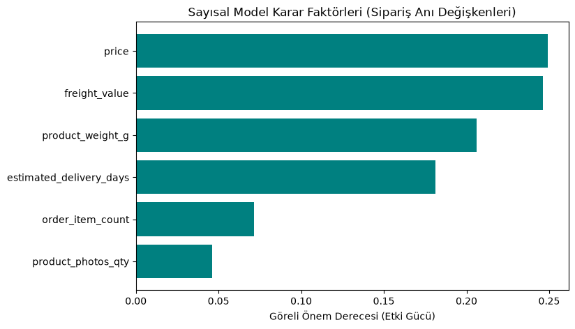
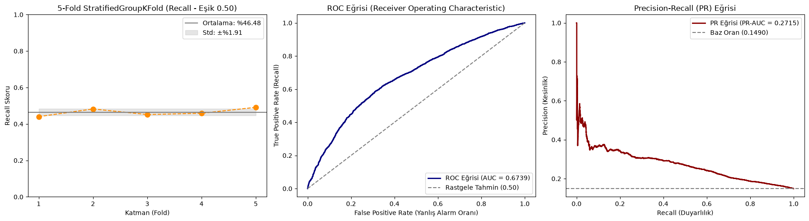
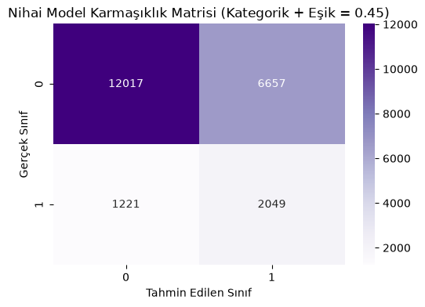

# Olist E-Ticaret Teslimat Riski ve İade Tahmini

## Problem Tanımı
E-ticaret operasyonlarında geciken teslimatlar ve ürün iadeleri doğrudan müşteri memnuniyetsizliğine ve lojistik maliyet artışına yol açar. Bu projede, sipariş ve lojistik verileri kullanılarak gecikme/iade riski yüksek siparişlerin önceden tahmin edilmesi amaçlanmıştır.

> **Not:** Olist veri setinde doğrulanmış bir iade etiketi bulunmadığından hedef değişken, memnuniyetsizlik/iade riskinin vekili olarak **1-2 yıldızlı değerlendirme (`is_risk = 1`)** şeklinde tanımlanmıştır. Model yalnızca **sipariş anında bilinen** değişkenleri kullanır (veri sızıntısı yok).

## Kullanılan Araçlar
- **Dil & Kütüphaneler:** Python, Pandas, NumPy, Scikit-learn, Imbalanced-learn (SMOTE)
- **Görselleştirme:** Matplotlib, Seaborn

## Uygulanan Yöntem
1. **Veri Hazırlama ve Özellik Mühendisliği:** 6 ilişkisel tablo + kategori çeviri tablosu birleştirildi (~110 bin ürün kalemi), eksik veriler temizlendi, tahmini teslimat süresi ve kategori bazlı risk metrikleri türetildi.
2. **Dengesiz Veri Yönetimi:** Sınıf dengesizliği için **SMOTE** denendi; Recall'u düşürdüğü görüldüğü için nihai modelde `class_weight='balanced'` tercih edildi.
3. **Modelleme ve Optimizasyon:** Baseline olarak **Logistic Regression** kuruldu, ardından `RandomizedSearchCV` ile hiperparametre optimizasyonu yapılan **Random Forest** ile performans iyileştirildi. Doğrulama: sipariş bazlı bölme (`GroupShuffleSplit`), 5-Fold `StratifiedGroupKFold` ve zamansal test.

## Elde Edilen Çıktı / Ekran Görüntüsü
- Modelin temel başarı metrikleri (test seti, %45 karar eşiği): **Recall: %62,7 | F1-Score: %34,2 (risk sınıfı) | ROC-AUC: 0,67**
  - Precision %23,5, PR-AUC 0,27; 5-Fold CV Recall (eşik 0,50): %46,5 (±1,9)
  - Zamansal testte ROC-AUC 0,63 → zamanla veri kayması nedeniyle periyodik yeniden eğitim gerekir.
- Riski en çok etkileyen temel değişkenler belirlendi *(tahmini teslimat süresi, kargo ücreti, fiyat, ürün ağırlığı; kategori bazında ofis mobilyası ve erkek giyim)*.



| ROC / PR Eğrileri | Confusion Matrix |
|---|---|
|  |  |

## Klasör Yapısı
```
olist_ecommerce_project_2/
├── data/               # Veri linki içeren README (CSV'leri buraya koyun)
├── notebooks/          # 1_veri_birlestirme.ipynb (EDA + modelleme)
├── images/             # ROC-AUC, Confusion Matrix, Feature Importance vb. grafikler
├── requirements.txt
└── README.md
```

## Çalıştırma
```bash
pip install -r requirements.txt
# Kaggle CSV dosyalarını data/ klasörüne indirin, ardından notebook'u açın
jupyter notebook notebooks/1_veri_birlestirme.ipynb
```
