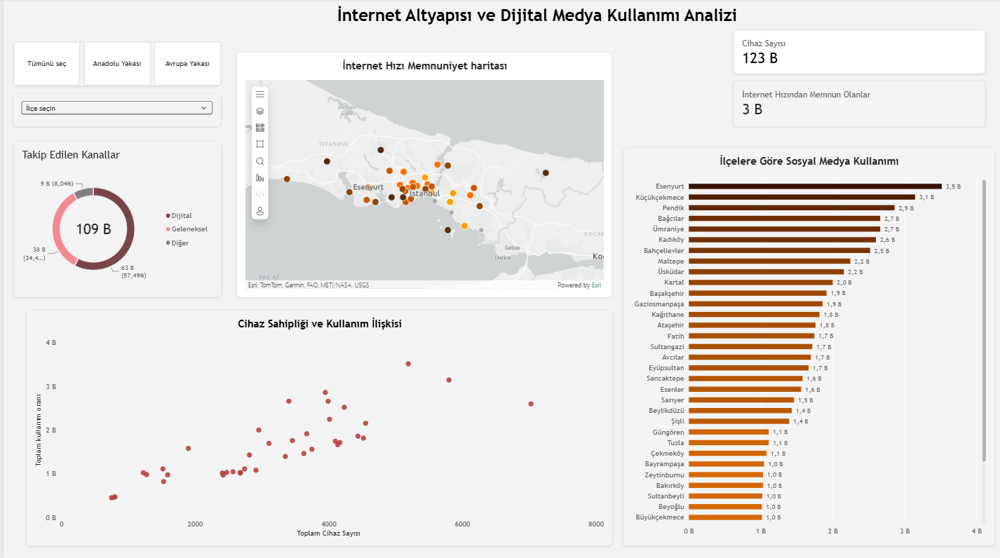
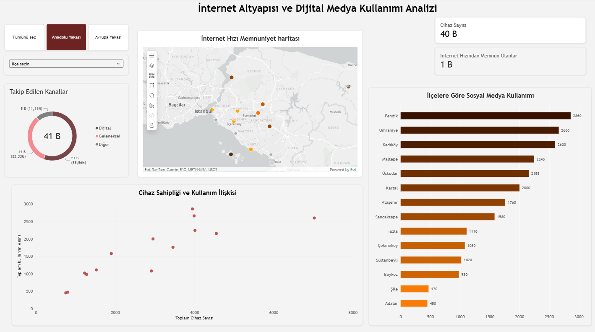

# İstanbul İlçe Bazlı İnternet Memnuniyeti ve Medya Kullanımı (VDYM)

## Problem Tanımı
İstanbul'daki ilçeler arasında internet erişim memnuniyeti ve medya kullanım alışkanlıkları farklılık göstermektedir. Bu çalışma, İBB açık veri setlerini kullanarak karar vericiler için ilçe bazlı karşılaştırmalı ve etkileşimli bir iş zekası (BI) raporu sunmayı hedefler.

## Kullanılan Araçlar
- **İş Zekası & Görselleştirme:** Microsoft Power BI, DAX, Power Query
- **Veri Kaynağı:** İBB Açık Veri Portalı

## Uygulanan Yöntem
1. **Veri Dönüştürme (ETL):** Power Query ile veri tipleri standartlaştırıldı, ilçe isimleri ve boyut tabloları düzenlendi.
2. **Veri Modelleme & DAX:** İlçe bazlı memnuniyet skorları, ortalama kıyaslamaları ve dinamik filtreleme ölçüleri (measures) yazıldı.
3. **Dashboard Tasarımı:** Kullanıcı dostu filtreler, harita görselleştirmeleri ve KPI kartları ile tek ekranda okunabilir yapı kuruldu.

## Elde Edilen Çıktı / Ekran Görüntüsü
- İlçeler arası internet memnuniyet farkları ve baskın medya kanalları etkileşimli olarak filtrelenebilir hale getirildi.

 